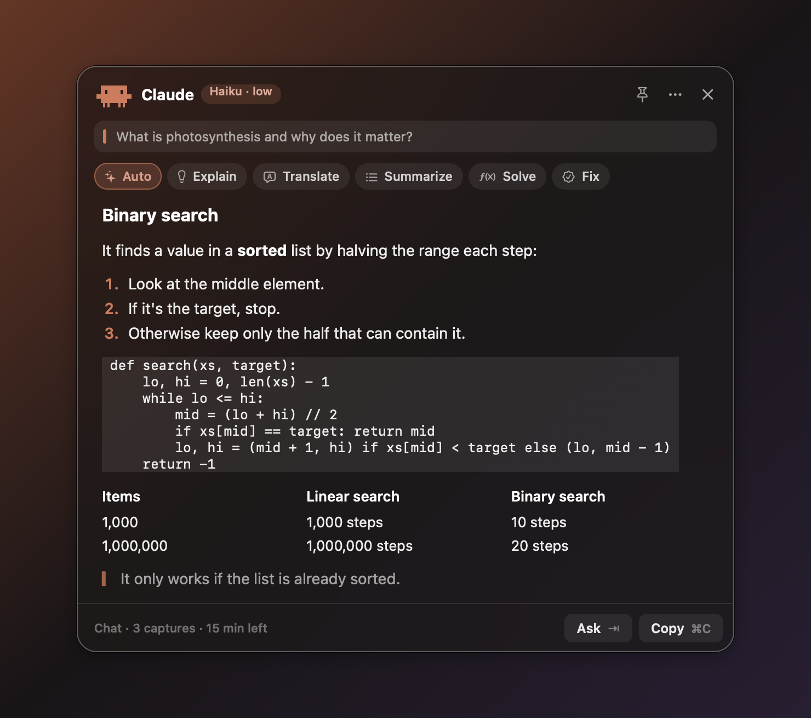
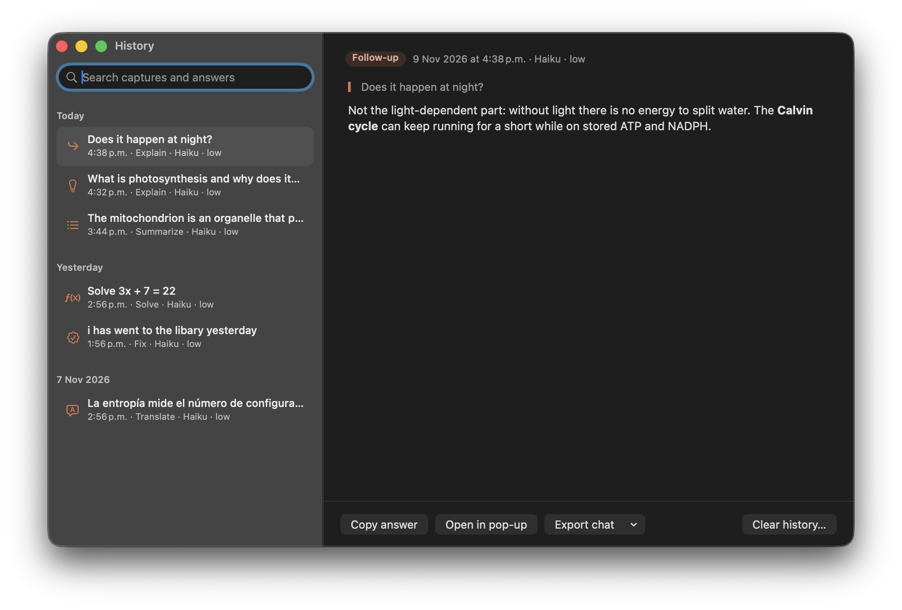

<div align="center">


# ClaudeSniper

**Capture anything on your screen with TextSniper and get Claude's take on it instantly.**

A native macOS menu bar app that connects [TextSniper](https://textsniper.app) to Claude, using **your Claude plan** (no API key).


<a href="docs/claudesniper-demo.mp4"></a>

<sub>▶ <a href="docs/claudesniper-demo.mp4">Watch the 31-second demo with sound (MP4)</a></sub>

</div>

---

## What it does

1. Press **⌘⇧2** and select part of your screen with TextSniper: a definition, an exam question, some code, a paragraph in another language…
2. ClaudeSniper picks up the capture and sends it to Claude.
3. A **pop-up appears next to your cursor** with the answer. No chat window to open.

<div align="center">

</div>

<table>
<tr>
<td width="50%"></td>
<td>

### Features

- **Live answers:** the text appears while Claude writes it, and the menu bar spark twinkles while Claude is answering.
- **Rich answers:** headings, lists, tables, quotes and code blocks are rendered, not shown as raw Markdown.
- **Model:** ⚡ Fast · Haiku · Sonnet · Opus · Fable. **Effort:** from *low* (seconds) to *max*.
- **⚡ Fast** (Super fast mode): Haiku with no extended thinking, from a Claude Code process that's already running and waiting. First words in about 1 second instead of 3–4.
- **6 quick modes:** ✨ Auto · 💡 Explain · 💬 Translate · ≡ Summarize · ƒ Solve · ✓ Fix. Keys **1–6** re-run the same capture in another mode.
- **Your own modes:** up to 3, with your own instruction (keys 7–9), from **My modes** in the menu.
- **Follow-up questions:** press **Tab** in the pop-up to ask "and why?" in the same chat.
- **Whole conversation:** click the chat status at the bottom of the pop-up (or ⌘T) to see the chat as a thread: earlier captures dimmed, the latest at the bottom. Clicking Mini Clawd opens it this way.
- **Replace:** in Fix and Translate, paste the result back where you captured it.
- **Read aloud** in the answer's language.
- **Chat memory:** captures in a row share context (15 minutes by default, adjustable). Start a new chat or switch between recent ones.
- **History:** every answer is saved, searchable and grouped by day. Open any answer in the pop-up again to keep asking, or **export a chat** to Markdown or Apple Notes.
- **Show last answer:** ⌥⌘2 brings the pop-up back.
- **Pin the pop-up:** the pin button (⌘P) keeps it open (no auto-close, esc doesn't close it) while you work next to it.
- **Mini Clawd mode:** instead of the pop-up, a tiny Clawd walks while Claude thinks and hops with a **!** when the answer is ready. Click it to open the answer, drag it anywhere, right-click to hide it (Settings → Mini Clawd).
- **Answer language:** match your Mac, or English, Español, Português, Français or Deutsch.
- **Settings:** answer length, pop-up position, auto-close, auto-copy, a sound when the answer arrives, Mini Clawd mode, a custom capture shortcut, open at login.
- **Images:** if the clipboard holds an image, Claude analyzes it.
- **Pixel-art Clawd** walks while Claude thinks.

</td>
</tr>
</table>

### In the pop-up

| Key | What it does |
|---|---|
| **1–6** (7–9 for your modes) | Re-run the same capture in another mode |
| **Tab** | Ask a follow-up in the same chat |
| **⌘C** | Copy the answer (or just the selected text) |
| **⌘↩** | Replace: paste the result where you captured it (Fix and Translate) |
| **⌘T** | Show the whole conversation |
| **⌘P** | Pin the pop-up open |
| **⌘R** | Read aloud |
| **⌘N** | New chat |
| **Esc** | Close |

The **⋯** button has the same actions, plus Export chat and History.

<div align="center">

<br><br>

</div>

<div align="center">

</div>

## Requirements

- macOS 13 Ventura or later.
- [TextSniper](https://textsniper.app) with its default **⌘⇧2** shortcut.
- [Claude Code](https://claude.com/claude-code) installed and signed in with your Claude account (Pro or Max):
  ```bash
  curl -fsSL https://claude.ai/install.sh | bash
  ```
- Xcode Command Line Tools (to build): `xcode-select --install`.

## Installation

### Download (no Xcode needed)

1. Download the latest **ClaudeSniper-x.y.z.zip** from [Releases](https://github.com/pacocuevasg/ClaudeSniper/releases/latest) and unzip it.
2. Move **ClaudeSniper.app** to **Applications** and open it.
3. The first time, macOS says it can't check the app (it isn't notarized by Apple): open **System Settings → Privacy & Security** and click **Open Anyway**.

Works on Apple Silicon and Intel.

### Or build it yourself

```bash
git clone https://github.com/pacocuevasg/ClaudeSniper.git
cd ClaudeSniper
./build.sh
open /Applications/ClaudeSniper.app
```

### First launch

A **welcome guide** checks that Claude Code is installed, helps you sign in, checks for TextSniper and lets you try a sample answer. You can reopen it from **Settings → Welcome guide**.

1. **Sign in to Claude…** opens Terminal with `claude auth login`.
2. Flip the switch on, pick a model, effort and mode, and try ⌘⇧2 in TextSniper.

No keyboard permission is needed: ClaudeSniper notices TextSniper's capture overlay when the text is copied.

> [!TIP]
> To preview the pop-up without using your plan: `open /Applications/ClaudeSniper.app --args --demo` (or `--demo-mini` for Mini Clawd)
>
> To test without TextSniper, copy some text and run `open /Applications/ClaudeSniper.app --args --interpret-clipboard --mode explain`

## How it works

```
⌘⇧2 in TextSniper ──► capture overlay on screen
                                         │
TextSniper copies the text ──► clipboard changes while the overlay is up
                                         │
                                         ▼
          claude -p --model … --effort … --session-id / --resume <chat>
                                         │
                                         ▼
                              pop-up with the answer
```

- **No API key:** it runs the Claude Code CLI in non-interactive mode (`claude -p --output-format stream-json`), so it uses your regular Claude plan and shows the answer as it's written. Your MCP servers aren't loaded (`--strict-mcp-config`), which keeps it fast.
- **Chats:** the first capture creates a session (`--session-id`) and later ones continue it (`--resume`) until the chat memory time passes without use.
- **One file:** [`main.swift`](main.swift), plain AppKit, no dependencies. The pixel art is drawn in code from text grids.

## Privacy

- No keyboard monitoring is needed: ClaudeSniper only checks whether TextSniper's capture window is on screen when the clipboard changes. (If you do allow *Input Monitoring*, it also listens for your capture shortcut with a listen-only event tap that never blocks or changes keys.)
- Only what TextSniper copies is sent to Claude (or what you send with "Interpret clipboard now").
- Conversations are stored where Claude Code keeps its sessions (`~/.claude/projects/`). The answer history is a local file (`~/Library/Application Support/ClaudeSniper/history.json`, last 500 answers) that you can clear from the History window. Temporary image captures are deleted after 24 hours.
- **Replace** pastes automatically only if you allow *Accessibility* (Settings → Allow auto-paste); otherwise it copies and you press ⌘V. **Export to Notes** asks macOS for permission to control Notes the first time.

## Customize

Most things are in the menu under **Settings**. For deeper changes, everything is at the top of [`main.swift`](main.swift):

- `systemPrompt`: how Claude answers (style, rules).
- `Theme`: the colors and corner radius used by the pop-up, the welcome window and the app icon.
- `builtInModes`: the six built-in quick action modes (name, SF Symbol icon and instruction). For your own modes you don't need code: use **My modes** in the menu.
- `languages`: the answer languages offered in the menu.
- `Settings` and the `…Options` lists: the choices shown in the Settings menu.

Then run `./build.sh` again.

## Disclaimer

A personal project, not affiliated with Anthropic or TextSniper. Claude and Clawd are trademarks of Anthropic; TextSniper belongs to its developer.

## License

[MIT](LICENSE) © Paco Cuevas
