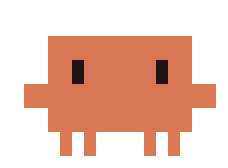
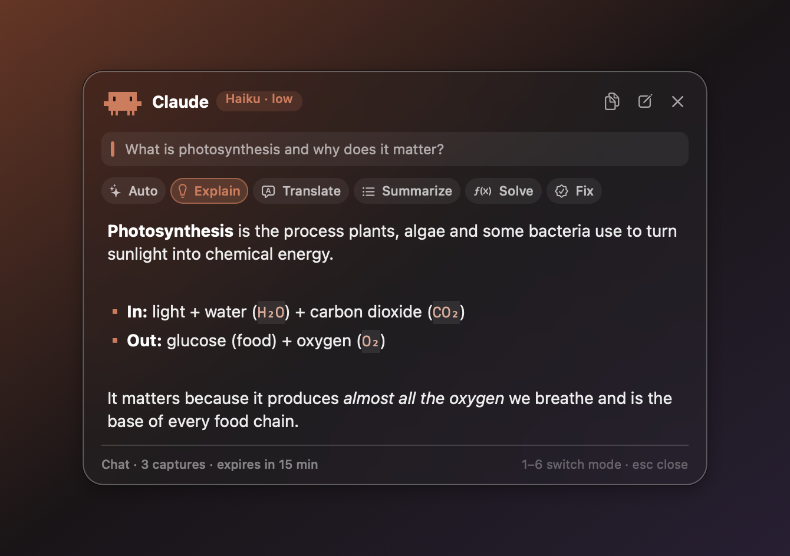
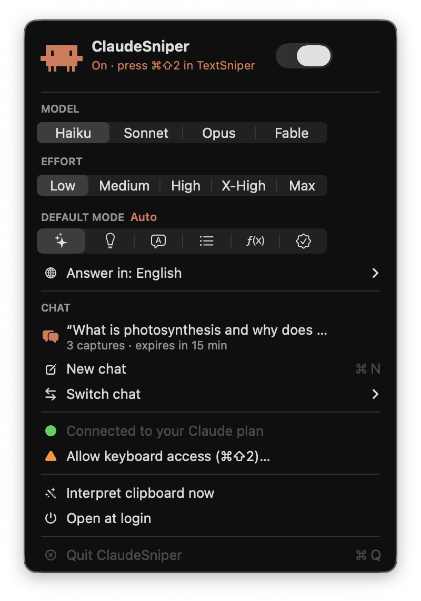
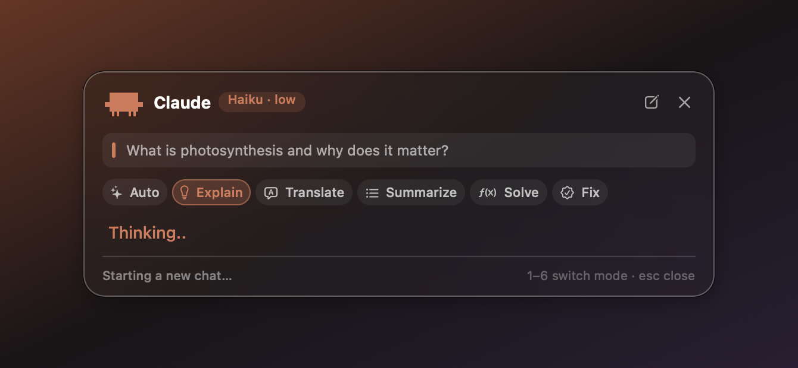

<div align="center">



# ClaudeSniper

**Capture anything on your screen with TextSniper and get Claude's take on it instantly.**

A native macOS menu bar app that connects [TextSniper](https://textsniper.app) to Claude, using **your Claude plan** (no API key).




</div>

---

## What it does

1. Press **⌘⇧2** and select part of your screen with TextSniper: a definition, an exam question, some code, a paragraph in another language…
2. ClaudeSniper picks up the capture and sends it to Claude.
3. A **pop-up appears next to your cursor** with the answer. No chat window to open.

<table>
<tr>
<td width="50%"></td>
<td>

### Features

- **On/off toggle** in the menu bar (the spark turns orange when it's on).
- **Model:** Haiku · Sonnet · Opus · Fable.
- **Effort:** from *low* (answers in seconds) to *max*.
- **6 quick action modes:** ✨ Auto · 💡 Explain · 💬 Translate · ≡ Summarize · ƒ Solve · ✓ Fix.
- **Re-run the same capture in another mode** with the pop-up buttons or keys **1–6**.
- **Chats with 15-minute memory:** captures in a row share context; after 15 minutes without use, a new chat starts. You can also start a new chat or switch between recent ones.
- **Answer language:** match your Mac, or pick English, Español, Português, Français or Deutsch.
- **Images:** if the clipboard holds an image, Claude analyzes it.
- **Pixel-art Clawd** walks while Claude thinks.
- Copy the answer, open at login, `esc` to close.

</td>
</tr>
</table>

<div align="center">

</div>

## Requirements

- macOS 13 Ventura or later.
- [TextSniper](https://textsniper.app) with its default **⌘⇧2** shortcut.
- [Claude Code](https://claude.com/claude-code) installed and signed in with your Claude account (Pro or Max):
  ```bash
  curl -fsSL https://claude.ai/install.sh | bash
  ```
- Xcode Command Line Tools (to build): `xcode-select --install`.

## Installation

```bash
git clone https://github.com/pacocuevasg/ClaudeSniper.git
cd ClaudeSniper
./build.sh
open /Applications/ClaudeSniper.app
```

The first time, from the ✨ menu in the menu bar:

1. **Sign in to Claude…** opens Terminal with `claude auth login`.
2. **Allow keyboard access (⌘⇧2)…**: turn on ClaudeSniper in *System Settings → Privacy & Security → Input Monitoring*.
3. Flip the switch on, pick a model, effort and mode, and try ⌘⇧2.

> [!TIP]
> To preview the pop-up without using your plan: `open /Applications/ClaudeSniper.app --args --demo`

## How it works

```
⌘⇧2 ──► event tap (listen-only) ──► "armed" for 30 s
                                         │
TextSniper copies the text ──► clipboard changes
                                         │
                                         ▼
          claude -p --model … --effort … --session-id / --resume <chat>
                                         │
                                         ▼
                              pop-up with the answer
```

- **No API key:** it runs the Claude Code CLI in non-interactive mode (`claude -p`), so it uses your regular Claude plan.
- **Chats:** the first capture creates a session (`--session-id`) and later ones continue it (`--resume`) until 15 minutes pass without use.
- **One file:** [`main.swift`](main.swift), plain AppKit, no dependencies. The pixel art is drawn in code from text grids.

## Privacy

- The shortcut is detected with a **listen-only** event tap: it never blocks or changes any key, and it only reacts to ⌘⇧2.
- Only what TextSniper copies right after ⌘⇧2 is sent to Claude (or what you send with "Interpret clipboard now").
- Conversations are stored where Claude Code keeps its sessions (`~/.claude/projects/`). Temporary image captures are deleted after 24 hours.

## Customize

Everything is at the top of [`main.swift`](main.swift):

- `systemPrompt`: how Claude answers (length, style).
- `modes`: add or change quick action modes (name, SF Symbol icon and instruction).
- `languages`: the answer languages offered in the menu.
- `ChatStore.ttl`: how long chat memory lasts (15 minutes by default).

Then run `./build.sh` again.

## Disclaimer

A personal project, not affiliated with Anthropic or TextSniper. Claude and Clawd are trademarks of Anthropic; TextSniper belongs to its developer.

## License

[MIT](LICENSE) © Paco Cuevas
